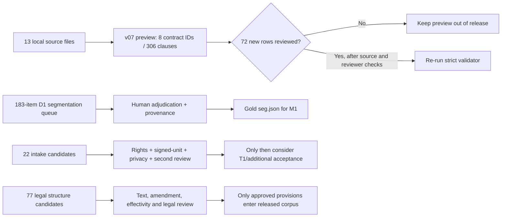

# N2 Data Lead status — 2026-11-01

This is a current, PII-free status snapshot of the data repository. It records
mechanical validation separately from human acceptance. Counts below describe
local files and queues; they do not establish rights, legal correctness, or
benchmark readiness.

## Current inventory and gates

| Area | Evidence observed | Status and consequence |
|---|---|---|
| Contract source files | 13 files `HDLD001`–`HDLD013` in `data/raw/contracts/` | Source files exist locally; this count is not the number of contracts admitted to a release or accepted for T1. |
| Clause preview v07 | 306 rows across 8 contract IDs: 234 `REVIEWED`, 72 `NEEDS_REVIEW` | Preview only. The 72 new rows are not gold and remain outside release. |
| Preview structural QC | `python -m scripts.audit_preview_dataset --details`: 0 structural errors, 12 grouped blocker categories | 234 rows with metadata have valid spans; 72 new rows remain pending and lack contract metadata across 3 contract IDs. |
| D1 segmentation | Baseline `HDLD001`–`HDLD004`: 183 clauses; a 183-item manual segmentation queue exists, including 9 `CONTEXT` items | Candidate labels/offsets exist; no adjudicated `seg.json` for M1 yet. |
| T1/additional intake | 22 source candidates; 10 review units, all `HOLD`; intake gate: 0/10 T1 and 0/20 additional accepted | Rights, executed-contract unit boundaries, redaction and independent review are not complete. |
| Legal source candidates | 77 structure nodes reported for two instruments; 20/21/22 transcriptions are candidates | Nodes and text remain `PENDING_LEGAL_REVIEW`; not available for approved retrieval or legal evaluation. |
| Legal citations | 14 locator rows; 2 link to clause IDs; all require human legal review | Locator queue is for review only and does not validate or correct a legal citation. |

## D1 segmentation queue audit (local, PII-free summary)

Ran `python -m scripts.audit_d1_segmentation_queue` against the ignored
private queue, v06 rows and the four canonical raw text files. The audit
confirmed 183/183 unique D1 clause IDs covered, 183/183 code-point spans
within bounds, and 0 missing rows. Per contract: HDLD001 39 (38 EXACT, 1
CONTEXT), HDLD002 40 EXACT, HDLD003 61 (59 EXACT, 2 CONTEXT), HDLD004 43
(37 EXACT, 6 CONTEXT). It reports 0 rows with reviewer ID or review note.
All 183 rows remain `PENDING_MANUAL_SEGMENTATION`; this is structural/offset
QC only and does not create adjudicated segmentation gold or validate privacy.

Added `scripts/validate_gold_segmentation.py` as the strict import gate for a
future adjudicated file: exact canonical-text SHA-256, Unicode code-point
half-open ranges, unique refs, sorted non-overlap, complete non-whitespace
partition, and distinct annotator/reviewer plus adjudicator decision metadata.
Seven synthetic tests pass. This validates future gold artifacts; it does not
annotate or approve the current D1 queue.

## V07 source/span reconciliation (preview only)

Extended `python -m scripts.audit_preview_dataset --details` to report
row/status/span counts per contract and check source metadata and exact spans.
Current local v07 has 306 rows: 234 historical reviewed rows and 72 new rows
still `NEEDS_REVIEW`. All 234 rows with an existing metadata record have
structurally valid source spans; 0 span errors were found. The 72 new rows
belong to HDLD010 (23), HDLD012 (36) and HDLD013 (13); these IDs have no
contract metadata records in this local table, so their offsets are not
counted as source-verified and all remain blocked from release. The five
v06 metadata version mismatches and all pending-review rows remain blockers.
No v07 or metadata row was changed by this audit.

## Checks run on 2026-11-01

- `python -m unittest discover -s tests -q` — **68 tests passed**, including 5 synthetic D1 queue-auditor tests and 8 synthetic gold-validator tests.
- `python -m scripts.audit_d1_segmentation_queue` — **PASS**: 183/183 IDs covered, 183/183 spans structurally valid, 0 reviewer/note rows filled; no clause text is emitted.
- `python -m scripts.audit_preview_dataset --details` — **72 new rows, all pending; 0 structural errors; 234 spans verified for rows with metadata; 72 new rows lack contract metadata, grouped under 3 contract IDs; 12 blocker groups**.
- `python scripts/validate_intake_gate.py` — **10 review units; accepted T1 0/10; accepted additional 0/20**.
- The legal citation locator was evaluated in memory against both v06 and v07; both yielded 14 locator records, 2 with linked clause IDs. No queue file was overwritten.

## Readiness path

## Next work, in dependency order

1. A human reviewer should adjudicate the 72 v07 rows against authorized source
   copies; preserve `NEEDS_REVIEW` until each decision has provenance.
2. Assign a named annotator and independent reviewer to the structurally
   validated 183-row D1 queue, adjudicate boundaries against authorized
   source copies, then create the canonical gold file. Keep all 9 `CONTEXT`
   spans out of exact-span scoring.
3. For contract acquisition, obtain documented authority and consent before
   processing or accepting any candidate; the current source-holder routes are
   research queues and have not been sent.
4. For the law corpus, verify source text, amendment history, effective dates,
   and every manual graph edge with a qualified legal reviewer. Keep draft
   legislation in a monitoring list only.
5. The pipeline checkout has a fixture-only M8 metric and paired callback
   runner. Connect them to actual prediction APIs and run on T2 only after
   gold and corpus approval.

The official-law freshness check is recorded separately in
`docs/LEGAL_SOURCE_STATUS_MONITOR_2026-11-01.md`. The pipeline repository's
N2 checklist/audit is separate from this data repository and must not be
confused with these dataset counts.
