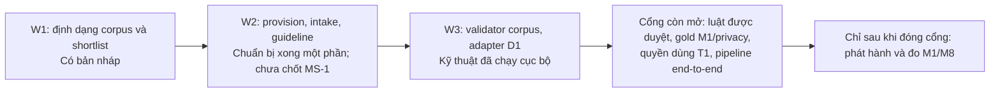

# Đối chiếu công việc Data Lead tuần 1–3 — 29/10/2026

Phạm vi: các đầu việc **N2** và các cổng chung liên quan trong `PROGRESS.md`
của repo nhóm; đối chiếu bằng trạng thái repo dữ liệu tại ổ D và hồ sơ kho
luật của repo nhóm. Trạng thái kỹ thuật không thay cho quyết định nhóm, quyền
xử lý dữ liệu cá nhân hoặc phê duyệt pháp lý.

| Mốc | Đầu việc | Trạng thái thực tế | Bằng chứng/việc còn thiếu |
| --- | --- | --- | --- |
| W1 | Định dạng corpus + 3–5 provision mẫu | Xong bản nháp phát triển | Repo nhóm có `manifest.yaml`, `provisions.jsonl`, `edges.jsonl`, `label_map.yaml` và 5 ứng viên Điều 21; `release_status: DRAFT`. |
| W1 | Danh mục luật tầng 1 dự thảo | Có dự thảo | P0 Bộ luật Lao động, P1 Nghị định 145/2020 và Thông tư 10/2020; chưa phải danh mục đã chốt. |
| W1 | Kiểm kê D1 và PII | Đã kiểm kê số lượng, chưa nghiệm thu privacy | HDLD001–004 có 183 clause; HDLD005 là 51 clause bổ sung v06. Chưa rà hình/metadata và chưa có quyết định D1 mở rộng. |
| W2/MS-1 | Freeze annotation guideline; chốt danh mục luật tầng 1 | Chưa chốt | Guideline v1.0 có trong repo dữ liệu; shortlist P0/P1 và 5 provision Điều 21 ở repo nhóm còn `DRAFT`, chưa có sign-off N2/N3/pháp lý. |
| W2/X-03 | Provisions đợt 1 + label map v0 | Bản nháp kỹ thuật | `data/legal_corpus/` của repo nhóm có loader, 5 provision ứng viên và label map; manifest `release_status: DRAFT`, không dùng runtime/cite/eval. |
| W2/X-10 | Bắt đầu thu hợp đồng T1 và quy trình ẩn danh | Đã bắt đầu; nghiệm thu 0 | Manifest có 22 candidate, tất cả `t1_eligible=no`; quy trình, hàng chờ, biểu mẫu xin quyền và tuyến liên hệ ở trạng thái nháp/chưa gửi. 0/10 T1, 0/20 bổ sung. |
| W3/C-12(a) | Loader/validator corpus + fixture | Hoàn thành phần kỹ thuật cục bộ | `PROGRESS.md` đánh dấu xong; chưa tích hợp production và chưa duyệt corpus. |
| W3/X-03 | Provision tầng 1 đủ cho baseline | Chưa đạt cổng | Mới có ứng viên Điều 21; thiếu phạm vi được nhóm chốt, nguyên văn/hiệu lực theo phiên bản và review độc lập. |
| W3/X-04 | Bắt đầu gold segmentation D1; adapter v06 | Adapter và hàng chờ đã có; gold M1 chưa có | D1 baseline HDLD001–004 có 183 clause; adapter tạo 183 label candidate, 9 `CONTEXT` có `span=null`; 183 mục trong hàng chờ private đang `PENDING_MANUAL_SEGMENTATION`. |
| W3/N3+N2 | Gold privacy D1 | Chưa hoàn tất | Rà regex trên raw text D1 không thấy email, chuỗi số liền 9–12 chữ số hay dạng điện thoại `0...`; chưa rà DOC/DOCX trực quan, tên/địa chỉ/ảnh và preserve spans; chưa có gold/reviewer. |
| W3/cổng nhóm | PDF → canonical → mask → segment, INV-01/02/03 | Chưa xác nhận tại repo dữ liệu | Cần chạy pipeline chung và kiểm kết quả trên D1; kiểm thử dữ liệu riêng không chứng minh cổng end-to-end. |

## Sơ đồ tiến độ

Sơ đồ biểu thị luồng phụ thuộc, không phải phần trăm hoàn thành. Mỗi ô có
thể chứa nhiều đầu việc của các role khác nhau.

## Kiểm tra D1 cục bộ ngày 29/10

| Hợp đồng | Clause v06 | EXACT | CONTEXT | Email/chuỗi số dài/điện thoại theo regex |
| --- | ---: | ---: | ---: | --- |
| HDLD001 | 39 | 38 | 1 | 0/0/0 |
| HDLD002 | 40 | 40 | 0 | 0/0/0 |
| HDLD003 | 61 | 59 | 2 | 0/0/0 |
| HDLD004 | 43 | 37 | 6 | 0/0/0 |
| **Tổng** | **183** | **174** | **9** | **0/0/0** |

Regex chỉ rà `raw_text/*.txt`; kết quả 0 không chứng minh không còn PII.
Ba file `.doc` chưa được rà hình/metadata; file `.docx` HDLD004 không có
`word/media/` nhưng vẫn cần kiểm bằng mắt và kiểm text/metadata. Không đưa
nội dung hợp đồng hoặc định danh cá nhân vào báo cáo này.

## Quyết định cần người phụ trách xác nhận

1. N1/N2/N3 chốt annotation guideline, chính sách đa nhãn và danh mục corpus
   P0/P1; reviewer pháp lý xác nhận từng provision và khoảng hiệu lực.
2. Người giữ nguồn cung cấp quyền lưu/xử lý/eval và bản đã ẩn danh; reviewer
   thứ hai kiểm độc lập trước khi nhận bất kỳ hợp đồng T1 nào.
3. Người gán nhãn và người kiểm xử lý 183 mục D1, ưu tiên 9 `CONTEXT`, tạo
   canonical `seg.json` và gold privacy có provenance/reviewer; sau đó mới đo
   M1 và số đo PII.
4. Nhóm chạy cổng end-to-end tuần 3 trong repo pipeline. Không tự đánh dấu
   cổng hoàn tất từ báo cáo repo dữ liệu.
